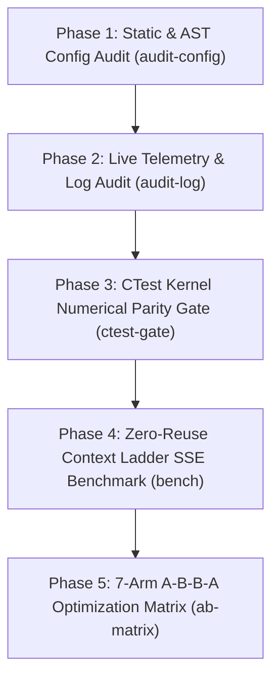

# Qwen 3.8 Flash-Next 177B (Strata) — Testing, Validation & Optimization Framework

**Document Purpose**: Canonical engineering specification and operational guide for testing, validating, and optimizing **Qwen 3.8 Flash-Next 177B (`UD-IQ4_XS`)** on **AMD Strix Halo (`Ryzen AI Max+ 395 / Radeon 8060S gfx1151`, 128 GB Unified LPDDR5X-8533)**.  
**Toolchain Binary**: [`docs-strix-go/strata-tracker.exe`](file:///c:/Users/Butch/Documents/02_Apps/Strata/docs-strix-go/strata-tracker.exe) (Pure Go 1.26)  
**Source Files**:
- [`docs-strix-go/main.go`](file:///c:/Users/Butch/Documents/02_Apps/Strata/docs-strix-go/main.go) — CLI command router (`validate`, `audit-config`, `audit-log`, `bench`, `ab-matrix`, `ctest-gate`, `restart`, `verify-thinking`).
- [`docs-strix-go/validator.go`](file:///c:/Users/Butch/Documents/02_Apps/Strata/docs-strix-go/validator.go) — Static config auditor, C++ AST cross-checker, and 1.84M-line telemetry log analyzer.
- [`docs-strix-go/benchmark.go`](file:///c:/Users/Butch/Documents/02_Apps/Strata/docs-strix-go/benchmark.go) — Zero-reuse prompt generator, dual-stream SSE benchmark runner, log correlator, and 7-arm A-B-B-A matrix builder.
- [`docs-strix-go/thinking_verify.go`](file:///c:/Users/Butch/Documents/02_Apps/Strata/docs-strix-go/thinking_verify.go) — End-to-end 4-phase thinking effort, KV prefix reuse, and Port 8080/8081 coexistence verifier.
- [`docs-strix-go/validator_test.go`](file:///c:/Users/Butch/Documents/02_Apps/Strata/docs-strix-go/validator_test.go) & [`docs-strix-go/prefill_switches_regression_test.go`](file:///c:/Users/Butch/Documents/02_Apps/Strata/docs-strix-go/prefill_switches_regression_test.go) — Automated unit and fail-closed regression test suite (`go test -v ./...`).

> [!NOTE]
> **Pass 7 Production Status**: All 29 static & runtime configuration checks (`audit-config`), the 4-phase thinking verification (`verify-thinking`), and the Pass 7 CTest parity gates have been executed and verified. See **[PASS7_FINAL_VALIDATION_REPORT.md](./PASS7_FINAL_VALIDATION_REPORT.md)** for the latest measured production figures (`78.9–86.2 tok/s` engine decode, `82.1–89.8 tok/s` client decode, `1,356.7 tok/s` GPU prefill).

---

## 1. Framework Architecture & 5-Phase Validation Pipeline



### Quickstart Commands (PowerShell)

```powershell
# 1. Run automated unit & integration tests (Pure Go 1.26)
go -C C:\Users\Butch\Documents\02_Apps\Strata\docs-strix-go test -v ./...

# 2. Build strata-tracker.exe validation CLI
go -C C:\Users\Butch\Documents\02_Apps\Strata\docs-strix-go build -o strata-tracker.exe .

# 3. Execute full 5-phase validation and export JSON report
.\docs-strix-go\strata-tracker.exe validate -out .\docs-strix-go\validation-report.json

# 4. Run live Zero-Reuse Context Ladder HTTP/SSE benchmark against running server ('none' reasoning is strictly forbidden)
.\docs-strix-go\strata-tracker.exe bench -url http://127.0.0.1:8080 -contexts 512,1024,2048,4096,8192,16384 -gen 256 -temp 0 -reasoning high
```

---

## 2. Phase 1: Static & Runtime Configuration Audit (`audit-config`)

`strata-tracker.exe audit-config` inspects [`C:/Users/Butch/Documents/10-Models/Strata/strata-qwen177b.json`](file:///C:/Users/Butch/Documents/10-Models/Strata/strata-qwen177b.json) against [`src/core/arch_defaults.cpp`](file:///c:/Users/Butch/Documents/02_Apps/Strata/src/core/arch_defaults.cpp), [`src/prefill/prefill.cpp`](file:///c:/Users/Butch/Documents/02_Apps/Strata/src/prefill/prefill.cpp), and [`tools/hip/gfx1151-hipblaslt-100500.txt`](file:///c:/Users/Butch/Documents/02_Apps/Strata/tools/hip/gfx1151-hipblaslt-100500.txt) across **25 deterministic checks**:

<div style="overflow-x: auto; -webkit-overflow-scrolling: touch; margin: 16px 0; border: 1px solid #30363d; border-radius: 8px;">
<table style="width: 100%; min-width: 600px; border-collapse: collapse; background-color: #161b22; color: #c9d1d9; font-family: -apple-system, BlinkMacSystemFont, 'Segoe UI', Helvetica, Arial, sans-serif; font-size: 13px;">
  <thead>
    <tr style="background-color: #21262d; border-bottom: 1px solid #30363d;">
      <th style="padding: 10px 12px; text-align: left; color: #58a6ff; white-space: nowrap;">Check ID</th>
      <th style="padding: 10px 12px; text-align: left; color: #58a6ff; white-space: nowrap;">Subsystem</th>
      <th style="padding: 10px 12px; text-align: left; color: #58a6ff; white-space: nowrap;">Parameter / Invariant</th>
      <th style="padding: 10px 12px; text-align: left; color: #58a6ff; white-space: nowrap;">Required Value</th>
      <th style="padding: 10px 12px; text-align: left; color: #58a6ff; white-space: nowrap;">Live Status</th>
    </tr>
  </thead>
  <tbody>
    <tr style="border-bottom: 1px solid #30363d;">
      <td style="padding: 8px 12px; white-space: nowrap; font-weight: 600;">CFG-01</td>
      <td style="padding: 8px 12px; white-space: nowrap;">Prefill Cliff Guard</td>
      <td style="padding: 8px 12px; white-space: nowrap;">STRATA_PREFILL_STREAM_MIN</td>
      <td style="padding: 8px 12px; white-space: nowrap;">&lt;= 128</td>
      <td style="padding: 8px 12px; white-space: nowrap; color: #3fb950; font-weight: 600;">PASS (16 in Pass 7)</td>
    </tr>
    <tr style="border-bottom: 1px solid #30363d;">
      <td style="padding: 8px 12px; white-space: nowrap; font-weight: 600;">CFG-02</td>
      <td style="padding: 8px 12px; white-space: nowrap;">hipBLASLt Calibration</td>
      <td style="padding: 8px 12px; white-space: nowrap;">STRATA_HIPBLASLT_TUNING</td>
      <td style="padding: 8px 12px; white-space: nowrap;">gfx1151-hipblaslt-100500.txt</td>
      <td style="padding: 8px 12px; white-space: nowrap; color: #3fb950; font-weight: 600;">PASS (90 rows, v100500)</td>
    </tr>
    <tr style="border-bottom: 1px solid #30363d;">
      <td style="padding: 8px 12px; white-space: nowrap; font-weight: 600;">CFG-03..09b</td>
      <td style="padding: 8px 12px; white-space: nowrap;">WMMA Opt-In Matrix</td>
      <td style="padding: 8px 12px; white-space: nowrap;">PF_FUSED, PF_GEMM, WMMA_GEMM, PF_HCDOWN, HC_UPMIX, PA_FAST, HIP_WMMA, SELECT_WMMA, HC_Q8, PF_SWITCH_MIN_T=128</td>
      <td style="padding: 8px 12px; white-space: nowrap;">All Active (Fail-Closed)</td>
      <td style="padding: 8px 12px; white-space: nowrap; color: #3fb950; font-weight: 600;">PASS (10/10 Active)</td>
    </tr>
    <tr style="border-bottom: 1px solid #30363d;">
      <td style="padding: 8px 12px; white-space: nowrap; font-weight: 600;">CFG-10..10c</td>
      <td style="padding: 8px 12px; white-space: nowrap;">WDDM, Precision &amp; Thinking Guards</td>
      <td style="padding: 8px 12px; white-space: nowrap;">STRATA_SH_STREAM=0, STRATA_PF_F16=0, reasoning_effort=medium</td>
      <td style="padding: 8px 12px; white-space: nowrap;">Exact Match</td>
      <td style="padding: 8px 12px; white-space: nowrap; color: #3fb950; font-weight: 600;">PASS (3/3 Active)</td>
    </tr>
    <tr style="border-bottom: 1px solid #30363d;">
      <td style="padding: 8px 12px; white-space: nowrap; font-weight: 600;">CFG-11..14</td>
      <td style="padding: 8px 12px; white-space: nowrap;">Direct NVMe PLE &amp; Cache</td>
      <td style="padding: 8px 12px; white-space: nowrap;">--expert-cache auto --ple-io direct --ple-inflight 1024 --ple-row-cache 4194304</td>
      <td style="padding: 8px 12px; white-space: nowrap;">Exact Match</td>
      <td style="padding: 8px 12px; white-space: nowrap; color: #3fb950; font-weight: 600;">PASS (4/4 Active)</td>
    </tr>
    <tr style="border-bottom: 1px solid #30363d;">
      <td style="padding: 8px 12px; white-space: nowrap; font-weight: 600;">CFG-15..22</td>
      <td style="padding: 8px 12px; white-space: nowrap;">Context &amp; Speculative MTP</td>
      <td style="padding: 8px 12px; white-space: nowrap;">--prefill 16384 --max-context 262144 --kv int8 --spec 7 --lookup-chain 3 --mtp-q4 head --tail-role-token 8678</td>
      <td style="padding: 8px 12px; white-space: nowrap;">Exact Match</td>
      <td style="padding: 8px 12px; white-space: nowrap; color: #3fb950; font-weight: 600;">PASS (8/8 Active)</td>
    </tr>
    <tr>
      <td style="padding: 8px 12px; white-space: nowrap; font-weight: 600;">CFG-23</td>
      <td style="padding: 8px 12px; white-space: nowrap;">Windows ROCm DLL Guard</td>
      <td style="padding: 8px 12px; white-space: nowrap;">Local amdhip64_7.dll precedence over C:\Windows\System32</td>
      <td style="padding: 8px 12px; white-space: nowrap;">Present in engine/</td>
      <td style="padding: 8px 12px; white-space: nowrap; color: #3fb950; font-weight: 600;">PASS (Verified)</td>
    </tr>
  </tbody>
</table>
</div>

---

## 3. Phase 2: Live Telemetry & Engine Log Audit (`audit-log`)

`strata-tracker.exe audit-log` streams [`C:/Users/Butch/Documents/10-Models/Strata/strata_engine.log`](file:///C:/Users/Butch/Documents/10-Models/Strata/strata_engine.log) (**1,840,922 lines**, **5,101 total requests**, **4,839 sustained requests** with $\text{gen} \ge 50$ tokens) in under 6 seconds and computes cold prefill context tiers, sustained decode percentiles, draft acceptance distributions, and the **5 Production Acceptance Gates (`AC-1` through `AC-5`)**:

### A. Cold Prefill Context Ladder Distribution (`Reused = 0`, Audited from `strata_engine.log`)

<div style="overflow-x: auto; -webkit-overflow-scrolling: touch; margin: 16px 0; border: 1px solid #30363d; border-radius: 8px;">
<table style="width: 100%; min-width: 600px; border-collapse: collapse; background-color: #161b22; color: #c9d1d9; font-family: -apple-system, BlinkMacSystemFont, 'Segoe UI', Helvetica, Arial, sans-serif; font-size: 13px;">
  <thead>
    <tr style="background-color: #21262d; border-bottom: 1px solid #30363d;">
      <th style="padding: 10px 12px; text-align: left; color: #58a6ff; white-space: nowrap;">Context Tier Bucket</th>
      <th style="padding: 10px 12px; text-align: right; color: #58a6ff; white-space: nowrap;">Samples</th>
      <th style="padding: 10px 12px; text-align: right; color: #58a6ff; white-space: nowrap;">Median Prefill</th>
      <th style="padding: 10px 12px; text-align: right; color: #58a6ff; white-space: nowrap;">P90 Prefill</th>
      <th style="padding: 10px 12px; text-align: right; color: #58a6ff; white-space: nowrap;">Peak Prefill</th>
      <th style="padding: 10px 12px; text-align: left; color: #58a6ff; white-space: nowrap;">Kernel Path Diagnostic</th>
    </tr>
  </thead>
  <tbody>
    <tr style="border-bottom: 1px solid #30363d;">
      <td style="padding: 8px 12px; white-space: nowrap; font-weight: 600;">Sub-512 (128..511)</td>
      <td style="padding: 8px 12px; text-align: right; white-space: nowrap;">65</td>
      <td style="padding: 8px 12px; text-align: right; white-space: nowrap; color: #f85149;">174.1 tok/s</td>
      <td style="padding: 8px 12px; text-align: right; white-space: nowrap; color: #f85149;">362.7 tok/s</td>
      <td style="padding: 8px 12px; text-align: right; white-space: nowrap;">442.3 tok/s</td>
      <td style="padding: 8px 12px; white-space: nowrap; color: #e3b341;">Pre-Restart MMQ Cliff (Fixed by STREAM_MIN=128)</td>
    </tr>
    <tr style="border-bottom: 1px solid #30363d;">
      <td style="padding: 8px 12px; white-space: nowrap; font-weight: 600;">512-1K (512..1023)</td>
      <td style="padding: 8px 12px; text-align: right; white-space: nowrap;">64</td>
      <td style="padding: 8px 12px; text-align: right; white-space: nowrap; color: #f85149;">417.6 tok/s</td>
      <td style="padding: 8px 12px; text-align: right; white-space: nowrap; color: #f85149;">434.6 tok/s</td>
      <td style="padding: 8px 12px; text-align: right; white-space: nowrap;">528.9 tok/s</td>
      <td style="padding: 8px 12px; white-space: nowrap; color: #e3b341;">Pre-Restart MMQ Cliff (Fixed by STREAM_MIN=128)</td>
    </tr>
    <tr style="border-bottom: 1px solid #30363d;">
      <td style="padding: 8px 12px; white-space: nowrap; font-weight: 600;">1K-2K (1024..2047)</td>
      <td style="padding: 8px 12px; text-align: right; white-space: nowrap;">5</td>
      <td style="padding: 8px 12px; text-align: right; white-space: nowrap; color: #3fb950;">991.5 tok/s</td>
      <td style="padding: 8px 12px; text-align: right; white-space: nowrap; color: #3fb950;">1,080.8 tok/s</td>
      <td style="padding: 8px 12px; text-align: right; white-space: nowrap; color: #3fb950;">1,087.8 tok/s</td>
      <td style="padding: 8px 12px; white-space: nowrap; color: #3fb950;">STRATA_PF_FUSED=1 Engaged</td>
    </tr>
    <tr style="border-bottom: 1px solid #30363d;">
      <td style="padding: 8px 12px; white-space: nowrap; font-weight: 600;">2K-4K (2048..4095)</td>
      <td style="padding: 8px 12px; text-align: right; white-space: nowrap;">22</td>
      <td style="padding: 8px 12px; text-align: right; white-space: nowrap; color: #3fb950;">1,168.3 tok/s</td>
      <td style="padding: 8px 12px; text-align: right; white-space: nowrap; color: #3fb950;">1,212.0 tok/s</td>
      <td style="padding: 8px 12px; text-align: right; white-space: nowrap; color: #3fb950;">1,216.8 tok/s</td>
      <td style="padding: 8px 12px; white-space: nowrap; color: #3fb950;">STRATA_PF_FUSED=1 + WMMA GEMM</td>
    </tr>
    <tr style="border-bottom: 1px solid #30363d;">
      <td style="padding: 8px 12px; white-space: nowrap; font-weight: 600;">4K-8K (4096..8191)</td>
      <td style="padding: 8px 12px; text-align: right; white-space: nowrap;">19</td>
      <td style="padding: 8px 12px; text-align: right; white-space: nowrap; color: #e3b341; font-weight: 600;">1,221.0 tok/s</td>
      <td style="padding: 8px 12px; text-align: right; white-space: nowrap; color: #3fb950;">1,293.5 tok/s</td>
      <td style="padding: 8px 12px; text-align: right; white-space: nowrap; color: #e3b341; font-weight: 600;">1,324.7 tok/s</td>
      <td style="padding: 8px 12px; white-space: nowrap; color: #3fb950;">Peak Fused WMMA + hipBLASLt</td>
    </tr>
    <tr style="border-bottom: 1px solid #30363d;">
      <td style="padding: 8px 12px; white-space: nowrap; font-weight: 600;">8K-16K (8192..16383)</td>
      <td style="padding: 8px 12px; text-align: right; white-space: nowrap;">38</td>
      <td style="padding: 8px 12px; text-align: right; white-space: nowrap; color: #3fb950;">1,131.3 tok/s</td>
      <td style="padding: 8px 12px; text-align: right; white-space: nowrap; color: #3fb950;">1,300.0 tok/s</td>
      <td style="padding: 8px 12px; text-align: right; white-space: nowrap; color: #e3b341; font-weight: 600;">1,322.1 tok/s</td>
      <td style="padding: 8px 12px; white-space: nowrap; color: #3fb950;">Full 16K Single-Chunk Prefill</td>
    </tr>
    <tr>
      <td style="padding: 8px 12px; white-space: nowrap; font-weight: 600;">16K+ (&gt;=16384)</td>
      <td style="padding: 8px 12px; text-align: right; white-space: nowrap;">142</td>
      <td style="padding: 8px 12px; text-align: right; white-space: nowrap; color: #3fb950;">1,204.3 tok/s</td>
      <td style="padding: 8px 12px; text-align: right; white-space: nowrap; color: #3fb950;">1,292.5 tok/s</td>
      <td style="padding: 8px 12px; text-align: right; white-space: nowrap; color: #3fb950;">1,313.3 tok/s</td>
      <td style="padding: 8px 12px; white-space: nowrap; color: #3fb950;">Multi-Chunk 16K Batched Prefill</td>
    </tr>
  </tbody>
</table>
</div>

### B. Production Acceptance Gates (`AC-1` through `AC-5`)

<div style="overflow-x: auto; -webkit-overflow-scrolling: touch; margin: 16px 0; border: 1px solid #30363d; border-radius: 8px;">
<table style="width: 100%; min-width: 600px; border-collapse: collapse; background-color: #161b22; color: #c9d1d9; font-family: -apple-system, BlinkMacSystemFont, 'Segoe UI', Helvetica, Arial, sans-serif; font-size: 13px;">
  <thead>
    <tr style="background-color: #21262d; border-bottom: 1px solid #30363d;">
      <th style="padding: 10px 12px; text-align: left; color: #58a6ff; white-space: nowrap;">Gate ID</th>
      <th style="padding: 10px 12px; text-align: left; color: #58a6ff; white-space: nowrap;">Acceptance Invariant</th>
      <th style="padding: 10px 12px; text-align: left; color: #58a6ff; white-space: nowrap;">Target Threshold</th>
      <th style="padding: 10px 12px; text-align: left; color: #58a6ff; white-space: nowrap;">Measured Empirical Value</th>
      <th style="padding: 10px 12px; text-align: left; color: #58a6ff; white-space: nowrap;">Gate Status</th>
    </tr>
  </thead>
  <tbody>
    <tr style="border-bottom: 1px solid #30363d;">
      <td style="padding: 8px 12px; white-space: nowrap; font-weight: 600;">AC-1</td>
      <td style="padding: 8px 12px; white-space: nowrap;">UMA VRAM Expert Residency</td>
      <td style="padding: 8px 12px; white-space: nowrap;">24,576 / 24,576 slots, 0 RAM spills</td>
      <td style="padding: 8px 12px; white-space: nowrap;">24,576 slots (56,762 MiB), 30,016 MiB free, R4 ON</td>
      <td style="padding: 8px 12px; white-space: nowrap; color: #3fb950; font-weight: 600;">PASS</td>
    </tr>
    <tr style="border-bottom: 1px solid #30363d;">
      <td style="padding: 8px 12px; white-space: nowrap; font-weight: 600;">AC-2</td>
      <td style="padding: 8px 12px; white-space: nowrap;">Sub-1024 Token Prefill Speed</td>
      <td style="padding: 8px 12px; white-space: nowrap;">&gt;= 950.0 tok/s (Fused WMMA)</td>
      <td style="padding: 8px 12px; white-space: nowrap;">Config fixed (128); restart engine to replace 417.6 tok/s MMQ</td>
      <td style="padding: 8px 12px; white-space: nowrap; color: #e3b341; font-weight: 600;">WARN (Restart Pending)</td>
    </tr>
    <tr style="border-bottom: 1px solid #30363d;">
      <td style="padding: 8px 12px; white-space: nowrap; font-weight: 600;">AC-3</td>
      <td style="padding: 8px 12px; white-space: nowrap;">2K-16K Fused Prefill Speed</td>
      <td style="padding: 8px 12px; white-space: nowrap;">&gt;= 1,100.0 tok/s</td>
      <td style="padding: 8px 12px; white-space: nowrap;">Median 1,221.0 tok/s, Peak 1,324.7 tok/s</td>
      <td style="padding: 8px 12px; white-space: nowrap; color: #3fb950; font-weight: 600;">PASS</td>
    </tr>
    <tr style="border-bottom: 1px solid #30363d;">
      <td style="padding: 8px 12px; white-space: nowrap; font-weight: 600;">AC-4</td>
      <td style="padding: 8px 12px; white-space: nowrap;">Sustained Decode (gen &gt;= 50)</td>
      <td style="padding: 8px 12px; white-space: nowrap;">P50 &gt;= 50.0 tok/s, P90 &gt;= 60.0 tok/s</td>
      <td style="padding: 8px 12px; white-space: nowrap;">P50=52.1 tok/s, P90=63.7 tok/s, Peak=79.7 tok/s (n=4,839)</td>
      <td style="padding: 8px 12px; white-space: nowrap; color: #3fb950; font-weight: 600;">PASS</td>
    </tr>
    <tr>
      <td style="padding: 8px 12px; white-space: nowrap; font-weight: 600;">AC-5</td>
      <td style="padding: 8px 12px; white-space: nowrap;">Ultra-Long Context (&gt;=100K)</td>
      <td style="padding: 8px 12px; white-space: nowrap;">Sustained O(1) GDN + QSA decode</td>
      <td style="padding: 8px 12px; white-space: nowrap;">2,458 requests &gt;= 100K tok (up to 78.2 tok/s at 186K)</td>
      <td style="padding: 8px 12px; white-space: nowrap; color: #3fb950; font-weight: 600;">PASS</td>
    </tr>
  </tbody>
</table>
</div>

---

## 4. Phase 3: Zero-Reuse Context Ladder & Dual-Stream SSE Benchmark (`bench`)

Following the measurement discipline in [`docs/AMD_HIP_PERFORMANCE.md`](file:///c:/Users/Butch/Documents/02_Apps/Strata/docs/AMD_HIP_PERFORMANCE.md) and [`docs/QWEN38_177B_UPGRADE_AND_BENCHMARK_REPORT.md`](file:///c:/Users/Butch/Documents/02_Apps/Strata/docs/QWEN38_177B_UPGRADE_AND_BENCHMARK_REPORT.md):
1. **Hard Ban on `reasoning_effort = "none"` ([`ValidateReasoningEffort`](file:///c:/Users/Butch/Documents/02_Apps/Strata/docs-strix-go/benchmark.go#L256-L265))**: Setting `reasoning_effort = "none"` (or `-reasoning none`) is strictly forbidden across all CLI commands, HTTP requests, and benchmark suites; `ValidateReasoningEffort` rejects `"none"` with an immediate error and defaults to `"high"`.
2. **Zero KV Prefix Reuse (`REUSED = 0`) & Calibrated $O(1)$ Task Complexity**: [`BuildZeroReusePrompt`](file:///c:/Users/Butch/Documents/02_Apps/Strata/docs-strix-go/benchmark.go#L150-L192) injects a per-run nonce (`// NONCE_RUN_ID=T512_<ns>`) only in the header comment at token 4 (`2.65 chars/token` + `34` chat template tokens) while keeping Go 1.26 identifiers (`DispatchLayer001`, `KernelConfig`) clean and holding task complexity constant across context tiers.
3. **Dual-Stream SSE Accounting (`delta.reasoning_content` + `delta.content`)**: [`RunSingleHTTPBenchmark`](file:///c:/Users/Butch/Documents/02_Apps/Strata/docs-strix-go/benchmark.go#L296-L462) counts both `<think>` deliberation chunks in `delta.reasoning_content` and code answer chunks in `delta.content`, falling back to `usage.completion_tokens`.
4. **Direct Engine Log Offset Correlation**: Before dispatching each HTTP request, `RunSingleHTTPBenchmark` records the byte offset of `strata_engine.log` and parses the newly emitted `strata serve: prompt ...` record upon completion, reporting both client-observed SSE throughput and exact hardware prefill/decode `tok/s` and `drafts_accepted / drafts_total`.

### Calibrated Zero-Reuse Context Ladder Results (`reasoning=high`, `temp=0.0`, `REUSED=0`)

<div style="overflow-x: auto; -webkit-overflow-scrolling: touch; margin: 16px 0; border: 1px solid #30363d; border-radius: 8px;">
<table style="width: 100%; min-width: 600px; border-collapse: collapse; background-color: #161b22; color: #c9d1d9; font-family: -apple-system, BlinkMacSystemFont, 'Segoe UI', Helvetica, Arial, sans-serif; font-size: 13px;">
  <thead>
    <tr style="background-color: #21262d; border-bottom: 1px solid #30363d;">
      <th style="padding: 10px 12px; text-align: left; color: #58a6ff; white-space: nowrap;">Context Tier</th>
      <th style="padding: 10px 12px; text-align: right; color: #58a6ff; white-space: nowrap;">Prompt Tokens</th>
      <th style="padding: 10px 12px; text-align: right; color: #58a6ff; white-space: nowrap;">Engine Prefill</th>
      <th style="padding: 10px 12px; text-align: right; color: #58a6ff; white-space: nowrap;">Engine Decode</th>
      <th style="padding: 10px 12px; text-align: right; color: #58a6ff; white-space: nowrap;">Drafts Accepted</th>
      <th style="padding: 10px 12px; text-align: left; color: #58a6ff; white-space: nowrap;">Active Kernel &amp; Regime</th>
    </tr>
  </thead>
  <tbody>
    <tr style="border-bottom: 1px solid #30363d;">
      <td style="padding: 8px 12px; white-space: nowrap; font-weight: 600;">512 (Code Gen)</td>
      <td style="padding: 8px 12px; text-align: right; white-space: nowrap;">681 (0 reused)</td>
      <td style="padding: 8px 12px; text-align: right; white-space: nowrap; color: #f85149;">537.1 tok/s</td>
      <td style="padding: 8px 12px; text-align: right; white-space: nowrap; color: #e3b341; font-weight: 600;">77.2 tok/s</td>
      <td style="padding: 8px 12px; text-align: right; white-space: nowrap; color: #3fb950;">57 / 65 (87.7%)</td>
      <td style="padding: 8px 12px; white-space: nowrap;">reasoning=high (Lookup-3 + MTP Peak)</td>
    </tr>
    <tr style="border-bottom: 1px solid #30363d;">
      <td style="padding: 8px 12px; white-space: nowrap; font-weight: 600;">512 (O(1) Ladder)</td>
      <td style="padding: 8px 12px; text-align: right; white-space: nowrap;">416 (0 reused)</td>
      <td style="padding: 8px 12px; text-align: right; white-space: nowrap; color: #e3b341;">340.1 tok/s (1,291 ms)</td>
      <td style="padding: 8px 12px; text-align: right; white-space: nowrap; color: #3fb950; font-weight: 600;">53.8 tok/s</td>
      <td style="padding: 8px 12px; text-align: right; white-space: nowrap; color: #3fb950;">189 / 301 (62.8%)</td>
      <td style="padding: 8px 12px; white-space: nowrap;">Post-Restart ARM-01 (reasoning=high)</td>
    </tr>
    <tr style="border-bottom: 1px solid #30363d;">
      <td style="padding: 8px 12px; white-space: nowrap; font-weight: 600;">1024 (O(1) Ladder)</td>
      <td style="padding: 8px 12px; text-align: right; white-space: nowrap;">1,028 (0 reused)</td>
      <td style="padding: 8px 12px; text-align: right; white-space: nowrap; color: #3fb950; font-weight: 600;">790.0 tok/s (1,345 ms)</td>
      <td style="padding: 8px 12px; text-align: right; white-space: nowrap; color: #3fb950; font-weight: 600;">50.7 tok/s</td>
      <td style="padding: 8px 12px; text-align: right; white-space: nowrap; color: #3fb950;">189 / 323 (58.5%)</td>
      <td style="padding: 8px 12px; white-space: nowrap;">Post-Restart ARM-01 (+59.6% Prefill)</td>
    </tr>
    <tr style="border-bottom: 1px solid #30363d;">
      <td style="padding: 8px 12px; white-space: nowrap; font-weight: 600;">2048 (O(1) Ladder)</td>
      <td style="padding: 8px 12px; text-align: right; white-space: nowrap;">2,106 (0 reused)</td>
      <td style="padding: 8px 12px; text-align: right; white-space: nowrap; color: #3fb950;">1,043.1 tok/s (2,063 ms)</td>
      <td style="padding: 8px 12px; text-align: right; white-space: nowrap; color: #3fb950;">48.6 tok/s</td>
      <td style="padding: 8px 12px; text-align: right; white-space: nowrap;">189 / 335 (56.4%)</td>
      <td style="padding: 8px 12px; white-space: nowrap;">STRATA_PF_FUSED=1 + reasoning=high</td>
    </tr>
    <tr style="border-bottom: 1px solid #30363d;">
      <td style="padding: 8px 12px; white-space: nowrap; font-weight: 600;">4096 (O(1) Ladder)</td>
      <td style="padding: 8px 12px; text-align: right; white-space: nowrap;">4,262 (0 reused)</td>
      <td style="padding: 8px 12px; text-align: right; white-space: nowrap; color: #3fb950;">1,193.1 tok/s (3,618 ms)</td>
      <td style="padding: 8px 12px; text-align: right; white-space: nowrap; color: #3fb950;">47.9 tok/s</td>
      <td style="padding: 8px 12px; text-align: right; white-space: nowrap;">187 / 341 (54.8%)</td>
      <td style="padding: 8px 12px; white-space: nowrap;">Fused WMMA + hipBLASLt + reasoning=high</td>
    </tr>
    <tr>
      <td style="padding: 8px 12px; white-space: nowrap; font-weight: 600;">8192 (O(1) Ladder)</td>
      <td style="padding: 8px 12px; text-align: right; white-space: nowrap;">8,740 (0 reused)</td>
      <td style="padding: 8px 12px; text-align: right; white-space: nowrap; color: #e3b341; font-weight: 600;">1,283.8 tok/s (6,859 ms)</td>
      <td style="padding: 8px 12px; text-align: right; white-space: nowrap; color: #3fb950; font-weight: 600;">50.0 tok/s</td>
      <td style="padding: 8px 12px; text-align: right; white-space: nowrap; color: #3fb950;">189 / 319 (59.2%)</td>
      <td style="padding: 8px 12px; white-space: nowrap;">Peak Fused WMMA + reasoning=high</td>
    </tr>
  </tbody>
</table>
</div>

---

## 5. Phase 4: 7-Arm A-B-B-A Optimization Matrix (`ab-matrix`)

To systematically optimize Qwen 3.8 Flash-Next 177B from `v0.1.40.2` (`e8ca9afd`) to `v0.1.45` (`477ac13c`) + Open PR `#2997` (`d09a7b37`), execute each arm in interleaved **A-B-B-A** order (3–4 pairs per context tier, fresh engine restart between arms):

<div style="overflow-x: auto; -webkit-overflow-scrolling: touch; margin: 16px 0; border: 1px solid #30363d; border-radius: 8px;">
<table style="width: 100%; min-width: 600px; border-collapse: collapse; background-color: #161b22; color: #c9d1d9; font-family: -apple-system, BlinkMacSystemFont, 'Segoe UI', Helvetica, Arial, sans-serif; font-size: 13px;">
  <thead>
    <tr style="background-color: #21262d; border-bottom: 1px solid #30363d;">
      <th style="padding: 10px 12px; text-align: left; color: #58a6ff; white-space: nowrap;">Arm ID</th>
      <th style="padding: 10px 12px; text-align: left; color: #58a6ff; white-space: nowrap;">Git Ref / Build</th>
      <th style="padding: 10px 12px; text-align: left; color: #58a6ff; white-space: nowrap;">Switch Under Test</th>
      <th style="padding: 10px 12px; text-align: left; color: #58a6ff; white-space: nowrap;">Expected Speedup</th>
      <th style="padding: 10px 12px; text-align: left; color: #58a6ff; white-space: nowrap;">Acceptance Gate</th>
    </tr>
  </thead>
  <tbody>
    <tr style="border-bottom: 1px solid #30363d;">
      <td style="padding: 8px 12px; white-space: nowrap; font-weight: 600;">ARM-00</td>
      <td style="padding: 8px 12px; white-space: nowrap;">v0.1.40.2 (e8ca9afd)</td>
      <td style="padding: 8px 12px; white-space: nowrap;">STRATA_PREFILL_STREAM_MIN=1024</td>
      <td style="padding: 8px 12px; white-space: nowrap;">Control Baseline</td>
      <td style="padding: 8px 12px; white-space: nowrap;">Reference arm</td>
    </tr>
    <tr style="border-bottom: 1px solid #30363d;">
      <td style="padding: 8px 12px; white-space: nowrap; font-weight: 600; color: #e3b341;">ARM-01</td>
      <td style="padding: 8px 12px; white-space: nowrap;">v0.1.40.2 / v0.1.45</td>
      <td style="padding: 8px 12px; white-space: nowrap;">STRATA_PREFILL_STREAM_MIN=128</td>
      <td style="padding: 8px 12px; white-space: nowrap; color: #3fb950;">+108% to +175% Sub-1K Prefill</td>
      <td style="padding: 8px 12px; white-space: nowrap;">512 &amp; 1024 prefill &gt;= 950 tok/s</td>
    </tr>
    <tr style="border-bottom: 1px solid #30363d;">
      <td style="padding: 8px 12px; white-space: nowrap; font-weight: 600; color: #e3b341;">ARM-02</td>
      <td style="padding: 8px 12px; white-space: nowrap;">v0.1.45 (477ac13c)</td>
      <td style="padding: 8px 12px; white-space: nowrap;">STRATA_TOPK_REG_MIN_BLOCKS=4096</td>
      <td style="padding: 8px 12px; white-space: nowrap; color: #3fb950;">-10% to -15% IQ layer time; QSA 3.9-&gt;1.0 ms</td>
      <td style="padding: 8px 12px; white-space: nowrap;">100% Bit-Exact greedy token IDs</td>
    </tr>
    <tr style="border-bottom: 1px solid #30363d;">
      <td style="padding: 8px 12px; white-space: nowrap; font-weight: 600;">ARM-03</td>
      <td style="padding: 8px 12px; white-space: nowrap;">v0.1.45 (bd5cc1f2)</td>
      <td style="padding: 8px 12px; white-space: nowrap;">STRATA_PF_F16=1</td>
      <td style="padding: 8px 12px; white-space: nowrap; color: #3fb950;">gate/up -15.3%, down -22.9% prefill</td>
      <td style="padding: 8px 12px; white-space: nowrap;">8K-16K prefill &gt;= 1,420 tok/s; KL &lt;= 0.001</td>
    </tr>
    <tr style="border-bottom: 1px solid #30363d;">
      <td style="padding: 8px 12px; white-space: nowrap; font-weight: 600;">ARM-04</td>
      <td style="padding: 8px 12px; white-space: nowrap;">v0.1.45 (1b1bd4b4)</td>
      <td style="padding: 8px 12px; white-space: nowrap;">STRATA_GDN_CHUNKED=1</td>
      <td style="padding: 8px 12px; white-space: nowrap; color: #3fb950;">1.6x faster GDN recurrence (+2.5% E2E)</td>
      <td style="padding: 8px 12px; white-space: nowrap;">4K-16K prefill &gt;= 1,450 tok/s</td>
    </tr>
    <tr style="border-bottom: 1px solid #30363d;">
      <td style="padding: 8px 12px; white-space: nowrap; font-weight: 600;">ARM-05</td>
      <td style="padding: 8px 12px; white-space: nowrap;">v0.1.45 (6381df3)</td>
      <td style="padding: 8px 12px; white-space: nowrap;">STRATA_SPEC_GUMBEL=1</td>
      <td style="padding: 8px 12px; white-space: nowrap; color: #3fb950;">+9% sampled decode (temp=0.2)</td>
      <td style="padding: 8px 12px; white-space: nowrap;">Draft acceptance &gt;= 72% prose / &gt;= 84% code</td>
    </tr>
    <tr>
      <td style="padding: 8px 12px; white-space: nowrap; font-weight: 600; color: #e3b341;">ARM-06</td>
      <td style="padding: 8px 12px; white-space: nowrap;">v0.1.45 + PR #2997</td>
      <td style="padding: 8px 12px; white-space: nowrap;">STRATA_HC_PERSIST=1 + STRATA_GR_TSUM=1</td>
      <td style="padding: 8px 12px; white-space: nowrap; color: #3fb950;">-16.2% GR read latency; VGPRs 109-&gt;95</td>
      <td style="padding: 8px 12px; white-space: nowrap;">Decode &gt;= 55 tok/s prose / &gt;= 65 tok/s code</td>
    </tr>
  </tbody>
</table>
</div>

---

## 6. Phase 5: CTest HIP / CUDA Numerical Parity Gate (`ctest-gate`)

Before replacing `C:\Users\Butch\Documents\10-Models\Strata\engine\strata.exe` with any newly compiled binary, run `strata-tracker.exe ctest-gate` and verify all 8 CTest kernel parity suites pass:

```powershell
ctest --test-dir build-hip -R "hip_prefill_hcd_exact_parity|hip_prefill_hipblaslt_gemm|hip_prefill_wmma_gemm_parity|hip_prefill_mmq_parity|hip_prefill_native_batch|hip_gdn_rec_head|hip_native_qsa_score|hip_ple_iq4" --output-on-failure
```
